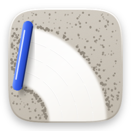
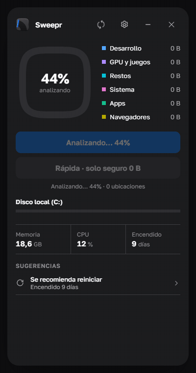
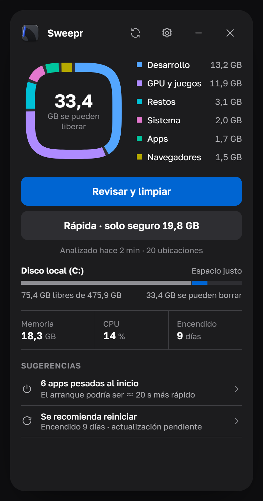
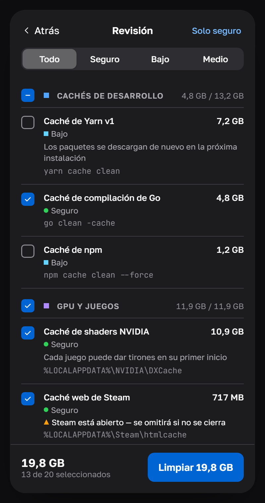
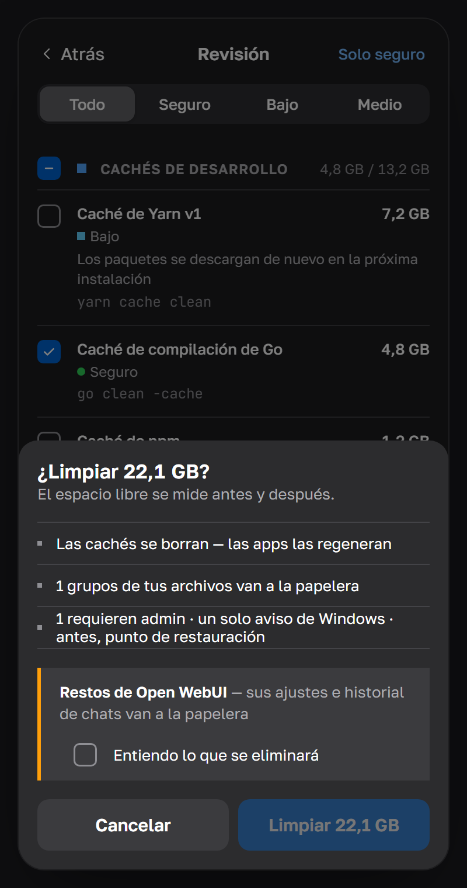
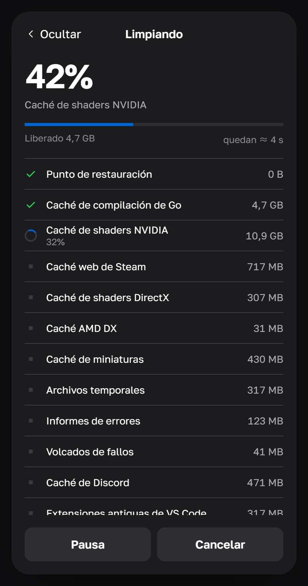
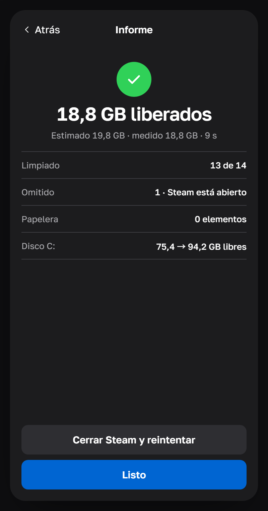
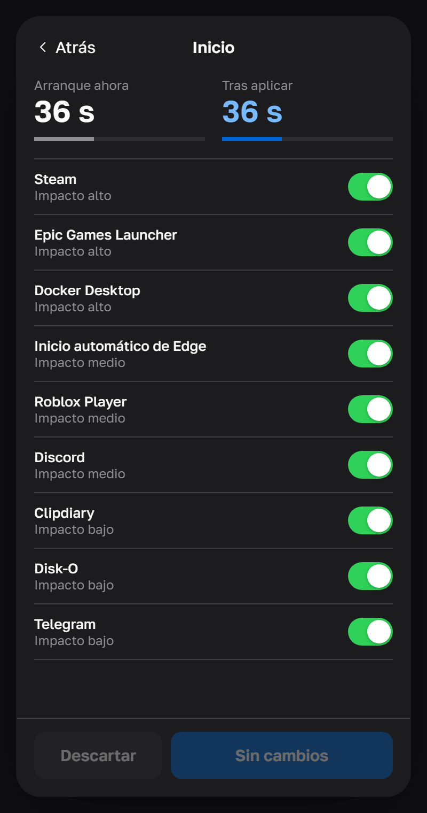
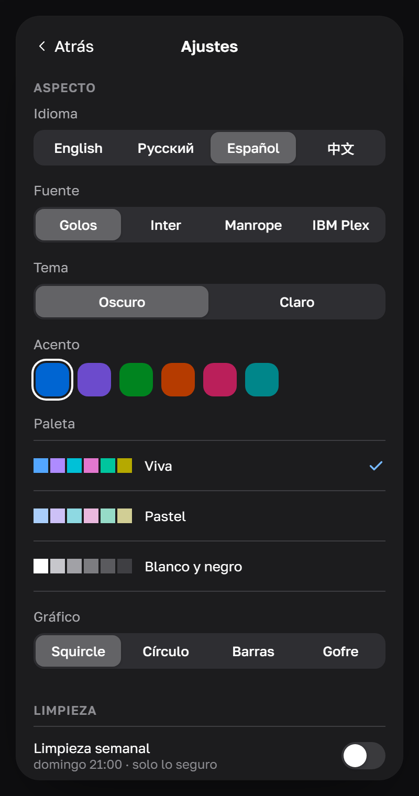
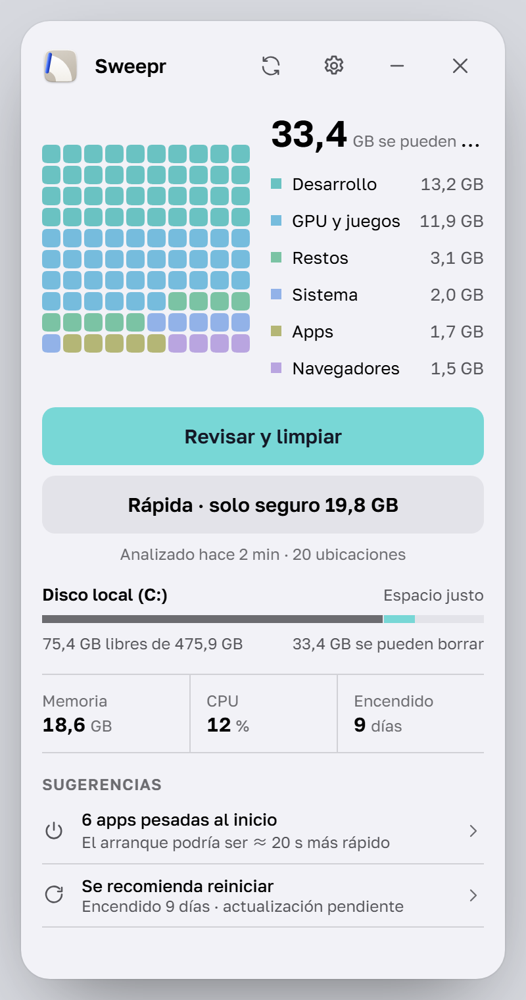

# Sweepr

**Un limpiador pequeño y cuidadoso para Windows 10 y 11.**
Encuentra la basura oculta, te muestra qué es exactamente y solo la elimina cuando tú lo confirmas.

[English](README.md) · [Русский](README.ru.md) · **Español** · [中文](README.zh.md)

[Ver en HD (MP4)](docs/media/es/demo.mp4)

## Descargar

Descarga **Sweepr_…_x64-setup.exe** de la [última versión](https://github.com/rom5n/sweepr/releases/latest) y ejecútalo.
El instalador todavía no está firmado: si Windows SmartScreen muestra «Windows protegió su PC», elige
**Más información → Ejecutar de todas formas**. Sweepr consulta esta página para buscar versiones nuevas
(puedes desactivarlo en Ajustes).

## Qué hace

- **Encuentra lo que otros pasan por alto.** Cachés de desarrollo (npm, Yarn, pnpm, Go, Cargo, Gradle, NuGet,
  Playwright…), cachés de shaders de la GPU, cachés de Steam y otros lanzadores, apps Electron, navegadores, cachés
  de Windows Update y de apps de Store, restos de programas desinstalados, instaladores viejos y discos virtuales de
  WSL/Docker que nunca se reducen solos.
- **Te lo muestra todo antes de borrar.** Cada elemento tiene su tamaño, su ruta y su riesgo con color, forma y
  palabra: Seguro, Bajo, Medio, Alto. Solo se preseleccionan los seguros.
- **Mide la verdad.** El espacio libre se mide antes y después: el informe muestra lo que de verdad recuperaste,
  no la suma de tamaños.
- **Con cuidado.** Las cachés se borran (las apps las regeneran); tus archivos van a la papelera. Los archivos abiertos
  se omiten, nunca se fuerzan. Lo de apps abiertas (Steam, navegadores, Discord…) espera a que las cierres.
- **Un solo aviso de Windows.** Lo que requiere administrador se ejecuta junto en un pequeño asistente, después de
  un punto de restauración, con un único aviso de UAC.
- **Apps de inicio** con su impacto y una estimación del arranque; se desactivan igual que en el Administrador de
  tareas y puedes deshacerlo cuando quieras.
- **Vive en la bandeja.** Limpieza rápida, nuevo análisis y limpieza automática programada (solo lo seguro, el día
  y la hora que elijas).

## Capturas

<table>
  <tr>
    <td align="center"> Inicio</td>
    <td align="center"> Revisión</td>
    <td align="center"> Confirmación</td>
    <td align="center"> Limpiando</td>
  </tr>
  <tr>
    <td align="center"> Informe</td>
    <td align="center"> Apps de inicio</td>
    <td align="center"> Ajustes</td>
    <td align="center"> Tema claro, gráfico gofre</td>
  </tr>
</table>

## Nunca se toca

Contraseñas y marcadores, extensiones del navegador, sesiones y datos sin conexión de las apps (Local Storage,
IndexedDB), partidas guardadas, carpetas de OneDrive y Dropbox, `Windows\Installer`, WinSxS, Prefetch, DriverStore,
volúmenes de Docker, máquinas virtuales, modelos de IA, carpetas de bases de datos y cualquier carpeta que añadas en
**Ajustes → Avanzado → Carpetas excluidas**. Nada de «limpiar el registro», y Sweepr nunca desactiva el archivo de
paginación, Windows Update, Defender, UAC ni SmartScreen.

## A tu manera

Cuatro idiomas (English, Русский, Español, 中文), tema oscuro y claro, seis colores de acento, tres paletas
(viva, pastel, blanco y negro), cuatro gráficos (squircle, círculo, barras, gofre), cuatro fuentes, tres estilos de
esquinas, animación reducida, alto contraste y estados para daltonismo.

## Privacidad

Sin cuenta y sin telemetría. La única petición de red es la comprobación opcional de actualizaciones en las
versiones de este repositorio. Cada archivo borrado queda en un registro local en `%LOCALAPPDATA%\Sweepr\logs`.

## Para desarrolladores

Compilación, estructura del proyecto, cómo añadir elementos de limpieza, pruebas y publicación de versiones:
[docs/DEVELOPMENT.md](docs/DEVELOPMENT.md) (en inglés).
