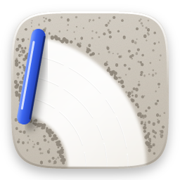
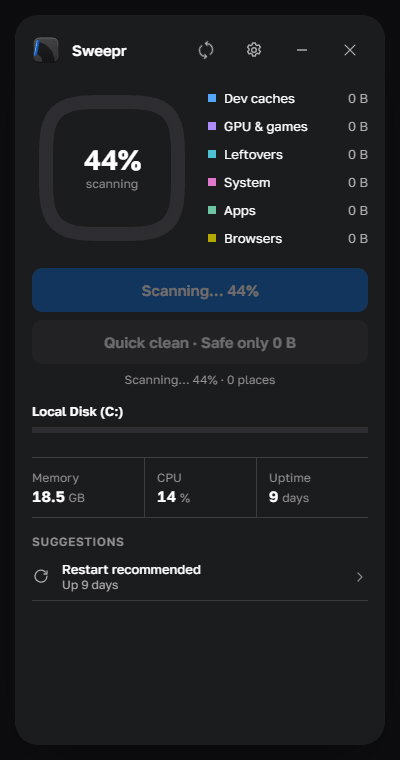
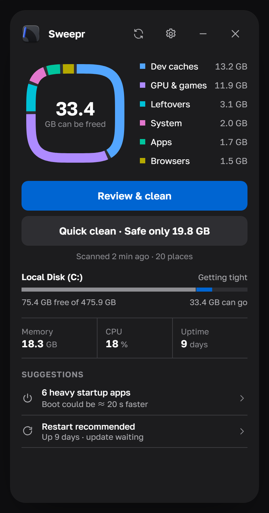
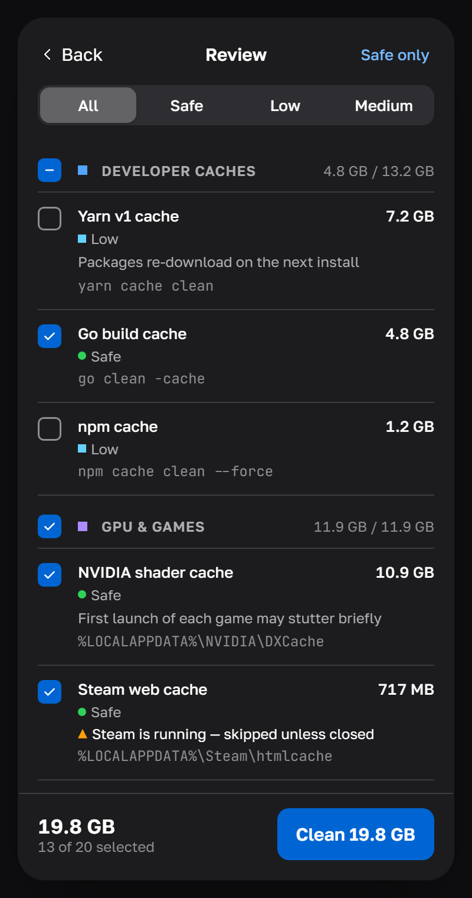
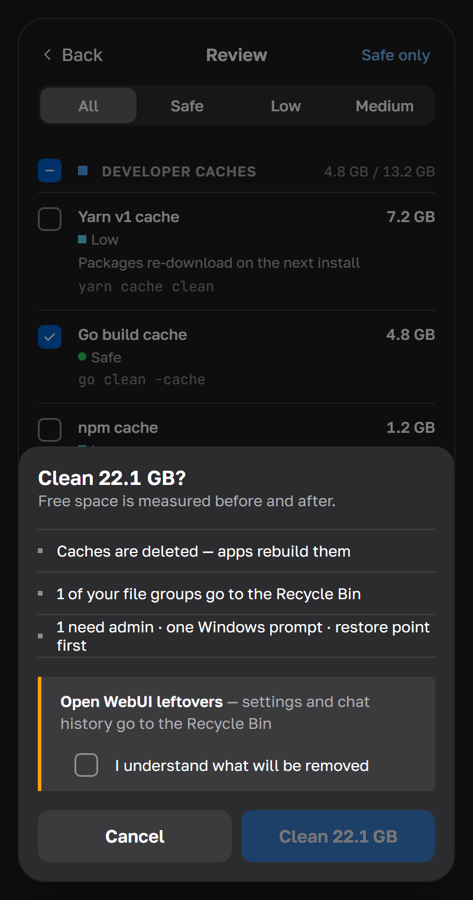
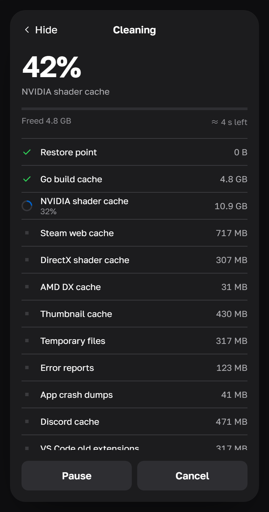
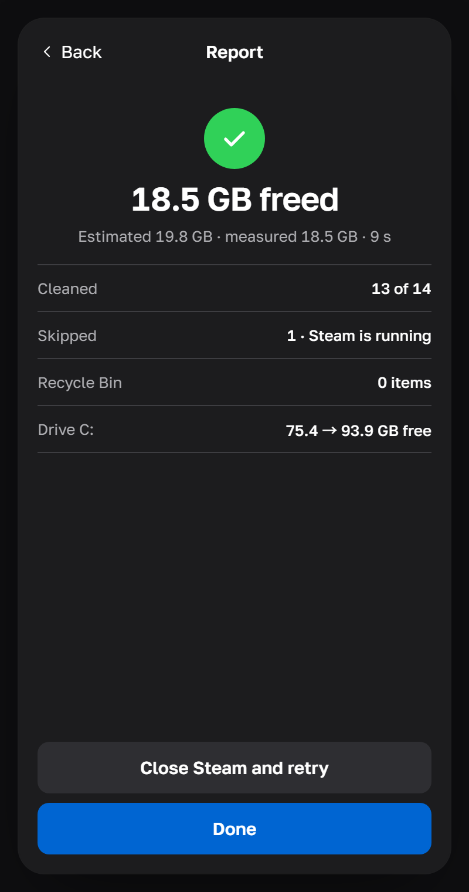
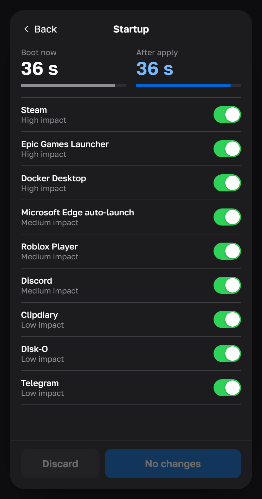
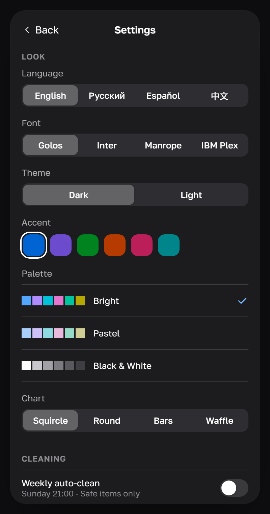
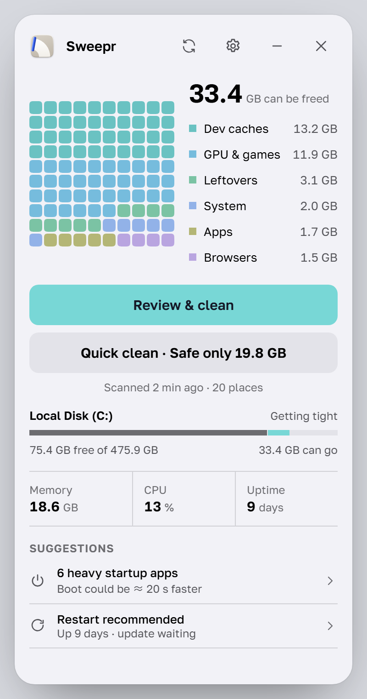

# Sweepr

**A small, careful cleaner for Windows 10 and 11.**
Finds hidden junk, shows exactly what it is, and removes it only after you say so.

**English** · [Русский](README.ru.md) · [Español](README.es.md) · [中文](README.zh.md)

[Watch in HD (MP4)](docs/media/en/demo.mp4)

## Download

Get **Sweepr_…_x64-setup.exe** from the [latest release](https://github.com/rom5n/sweepr/releases/latest) and run it.
The installer is not code-signed yet: if Windows SmartScreen says "Windows protected your PC", choose
**More info → Run anyway**. Sweepr checks this page for new versions (you can turn that off in Settings).

## What it does

- **Finds what other cleaners miss.** Developer caches (npm, Yarn, pnpm, Go, Cargo, Gradle, NuGet, Playwright…),
  GPU shader caches, Steam and launcher caches, Electron apps, browsers, Windows Update and Store app caches,
  leftovers of uninstalled apps, old installers, and WSL/Docker virtual disks that never shrink by themselves.
- **Shows everything before it deletes anything.** Every item has its size, path, and risk shown as color, shape
  and word: Safe, Low, Medium, High. Only Safe items are selected for you.
- **Measures the truth.** Free space is measured before and after, so the report shows what you really got back,
  not the sum of file sizes.
- **Plays it safe.** Caches are deleted (apps rebuild them); your own files go to the Recycle Bin. Open files are
  skipped, never forced. Items of running apps (Steam, browsers, Discord…) wait until you close them.
- **One Windows prompt.** Admin items run together in a small helper after a restore point, under a single UAC
  prompt.
- **Startup apps** with impact and boot-time estimate; turn them off the way Task Manager does, and undo anytime.
- **Lives in the tray.** Quick clean, scan again, and an optional scheduled auto-clean (Safe items only, your day
  and time).

## Screenshots

<table>
  <tr>
    <td align="center"> Home</td>
    <td align="center"> Review</td>
    <td align="center"> Confirm</td>
    <td align="center"> Cleaning</td>
  </tr>
  <tr>
    <td align="center"> Report</td>
    <td align="center"> Startup apps</td>
    <td align="center"> Settings</td>
    <td align="center"> Light theme, waffle chart</td>
  </tr>
</table>

## Never touched

Passwords and bookmarks, browser extensions, app logins and offline data (Local Storage, IndexedDB), game saves,
OneDrive and Dropbox folders, `Windows\Installer`, WinSxS, Prefetch, DriverStore, Docker volumes, virtual machines,
AI models, database folders, and any folder you add under **Settings → Advanced → Excluded folders**.
No "registry cleaning", and Sweepr never turns off the pagefile, Windows Update, Defender, UAC or SmartScreen.

## Make it yours

Four languages (English, Русский, Español, 中文), dark and light themes, six accent colors, three palettes
(bright, pastel, black & white), four charts (squircle, round, bars, waffle), four fonts, three corner styles,
reduced motion, high contrast and colorblind-friendly status colors.

## Privacy

No account, no telemetry. The only network request is the optional update check against this repository's
releases. Every deleted file is written to a local log in `%LOCALAPPDATA%\Sweepr\logs`.

## For developers

Build steps, project structure, how to add a cleanup target, tests and the release pipeline:
[docs/DEVELOPMENT.md](docs/DEVELOPMENT.md).
