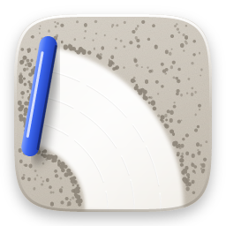
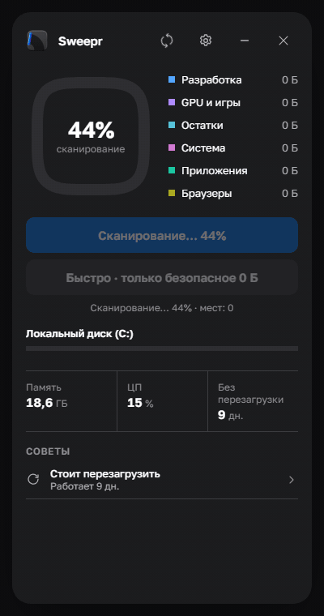
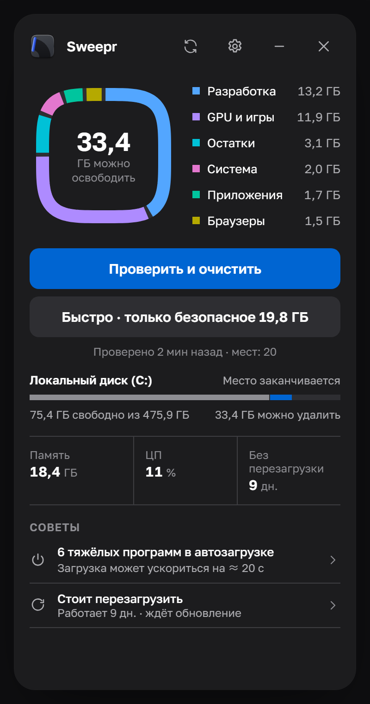
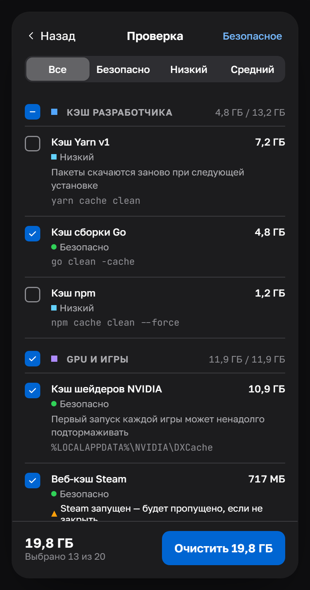
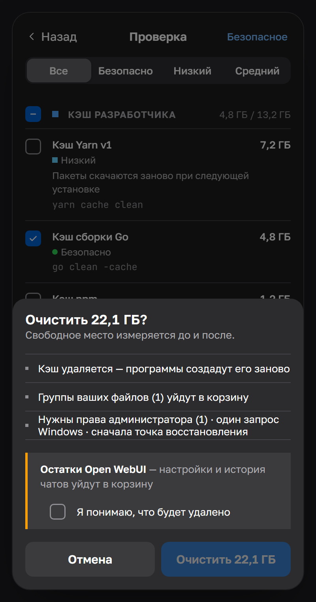
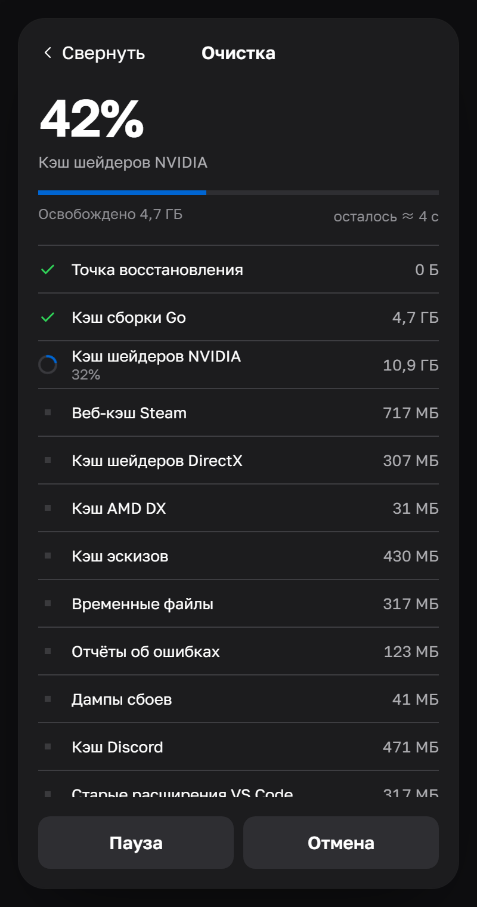
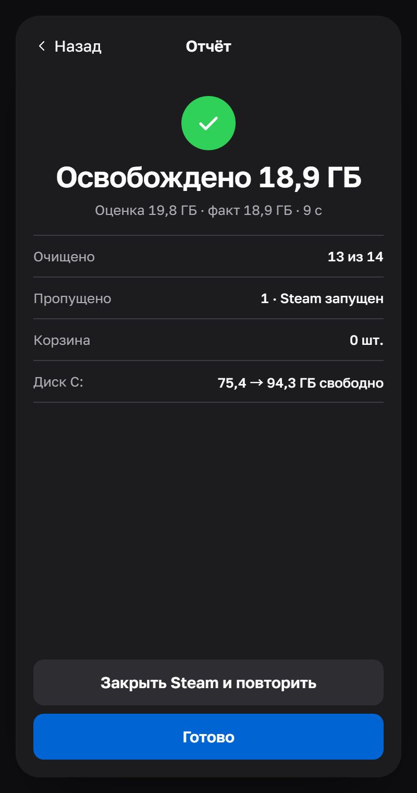
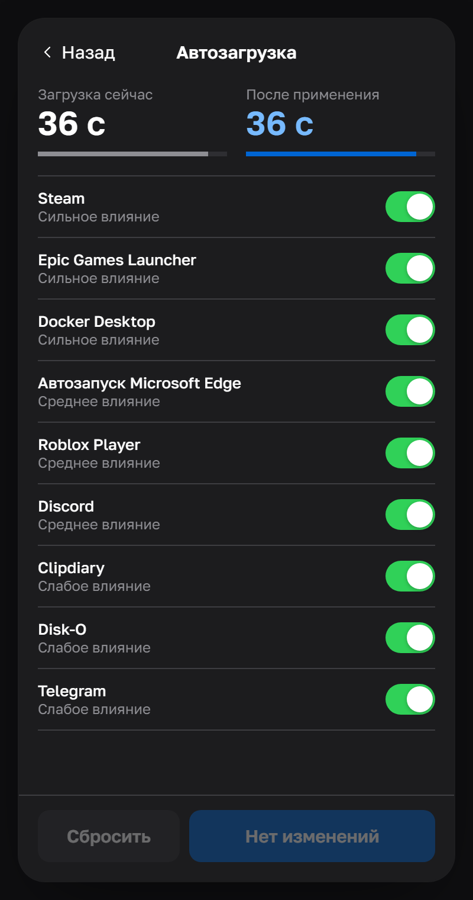
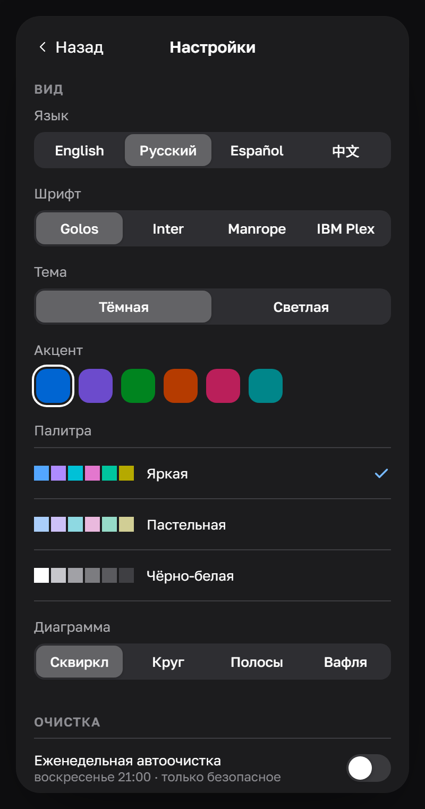
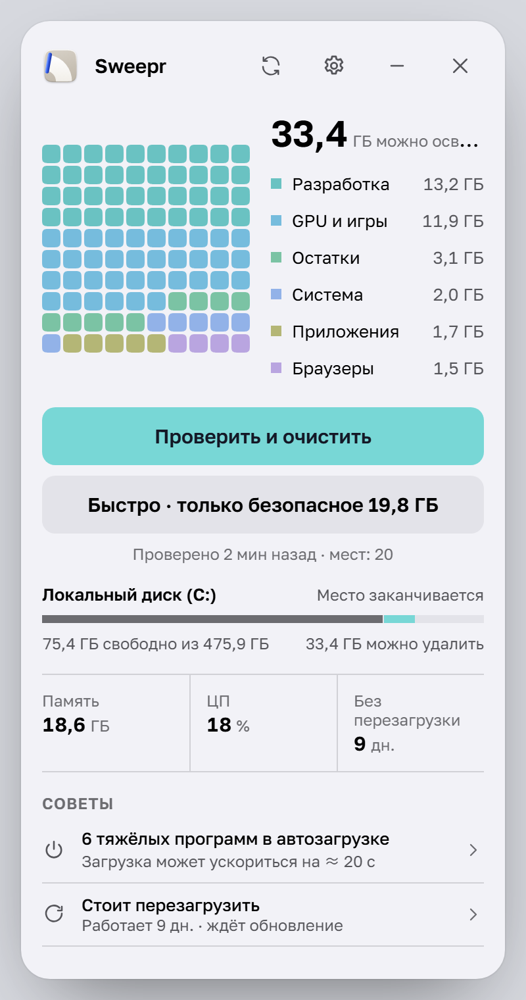

# Sweepr

**Небольшая и аккуратная очистка для Windows 10 и 11.**
Находит скрытый мусор, показывает, что именно это, и удаляет только после вашего подтверждения.

[English](README.md) · **Русский** · [Español](README.es.md) · [中文](README.zh.md)

[Смотреть в HD (MP4)](docs/media/ru/demo.mp4)

## Скачать

Скачайте **Sweepr_…_x64-setup.exe** из [последнего релиза](https://github.com/rom5n/sweepr/releases/latest) и запустите.
Установщик пока не подписан: если Windows SmartScreen пишет «Система Windows защитила ваш компьютер», нажмите
**Подробнее → Выполнить в любом случае**. Sweepr сам проверяет эту страницу на новые версии (это можно выключить в настройках).

## Что умеет

- **Находит то, что пропускают другие.** Кэш разработчика (npm, Yarn, pnpm, Go, Cargo, Gradle, NuGet, Playwright…),
  кэш шейдеров видеокарты, кэш Steam и лаунчеров, Electron-приложения, браузеры, кэш Центра обновления и приложений
  Store, остатки удалённых программ, старые установщики и виртуальные диски WSL/Docker, которые сами не уменьшаются.
- **Показывает всё до удаления.** У каждого пункта есть размер, путь и риск — цветом, формой и словом: безопасно,
  низкий, средний, высокий. Заранее выбрано только безопасное.
- **Измеряет честно.** Свободное место замеряется до и после — в отчёте реальный результат, а не сумма размеров файлов.
- **Бережно.** Кэш удаляется (программы создадут его заново), ваши файлы уходят в корзину. Открытые файлы
  пропускаются, никаких принудительных удалений. Пункты запущенных программ (Steam, браузеры, Discord…) ждут,
  пока вы их закроете.
- **Один запрос Windows.** Пункты с правами администратора выполняются вместе в маленьком помощнике после точки
  восстановления — под одним запросом UAC.
- **Автозагрузка** с оценкой влияния и времени загрузки; отключение тем же способом, что и в Диспетчере задач,
  с отменой в любой момент.
- **Живёт в трее.** Быстрая очистка, повторное сканирование и автоочистка по расписанию (только безопасное,
  в выбранный день и время).

## Скриншоты

<table>
  <tr>
    <td align="center"> Главная</td>
    <td align="center"> Проверка</td>
    <td align="center"> Подтверждение</td>
    <td align="center"> Очистка</td>
  </tr>
  <tr>
    <td align="center"> Отчёт</td>
    <td align="center"> Автозагрузка</td>
    <td align="center"> Настройки</td>
    <td align="center"> Светлая тема, «вафля»</td>
  </tr>
</table>

## Никогда не трогаем

Пароли и закладки, расширения браузеров, входы и офлайн-данные приложений (Local Storage, IndexedDB), сохранения
игр, папки OneDrive и Dropbox, `Windows\Installer`, WinSxS, Prefetch, DriverStore, тома Docker, виртуальные машины,
ИИ-модели, папки баз данных и любые папки из **Настройки → Дополнительно → Исключённые папки**.
Никакой «чистки реестра»; Sweepr никогда не отключает файл подкачки, Центр обновления, Defender, UAC и SmartScreen.

## Под себя

Четыре языка (English, Русский, Español, 中文), тёмная и светлая темы, шесть акцентных цветов, три палитры
(яркая, пастельная, чёрно-белая), четыре диаграммы (сквиркл, круг, полосы, вафля), четыре шрифта, три стиля углов,
уменьшенная анимация, высокий контраст и статусы для дальтоников.

## Приватность

Без аккаунта и без телеметрии. Единственный сетевой запрос — необязательная проверка обновлений в релизах этого
репозитория. Каждый удалённый файл записывается в локальный журнал `%LOCALAPPDATA%\Sweepr\logs`.

## Для разработчиков

Сборка, структура проекта, добавление новых пунктов очистки, тесты и выпуск релизов:
[docs/DEVELOPMENT.md](docs/DEVELOPMENT.md) (на английском).
