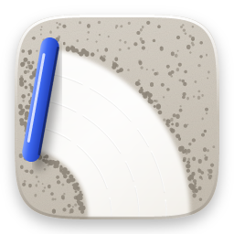
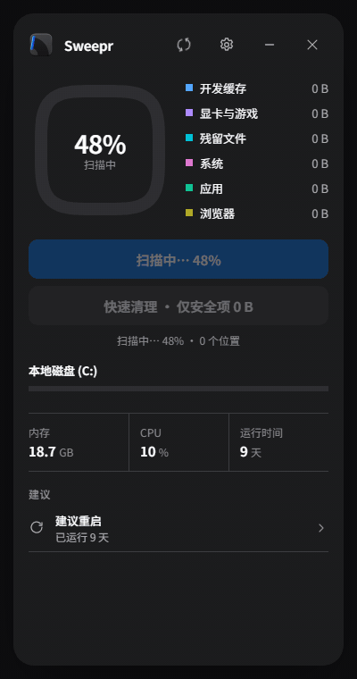
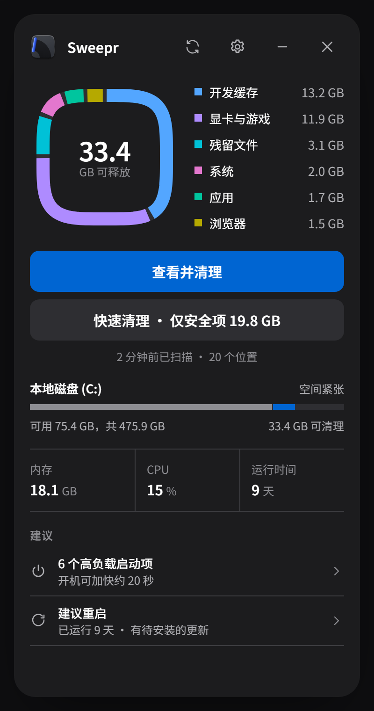
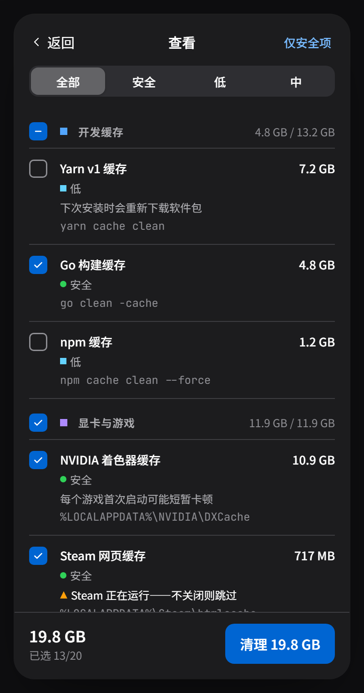
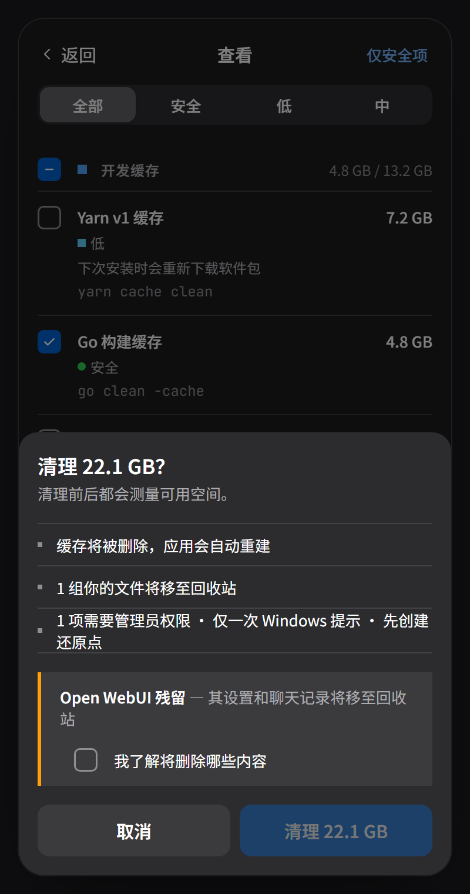
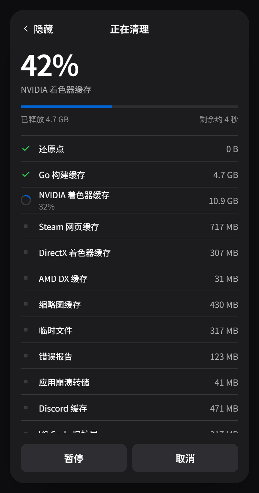
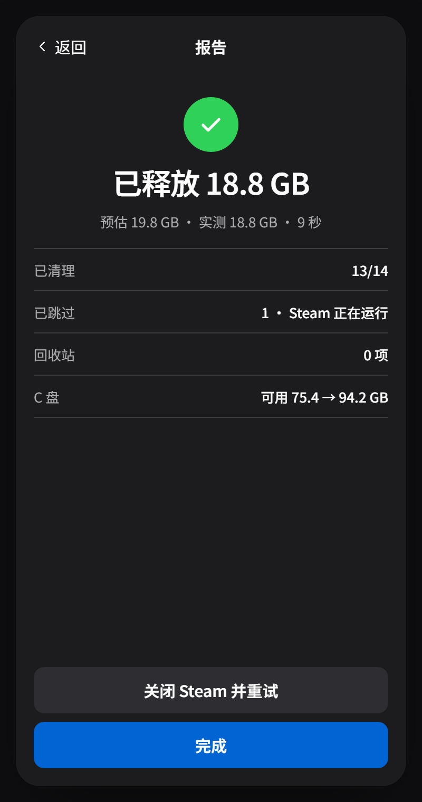
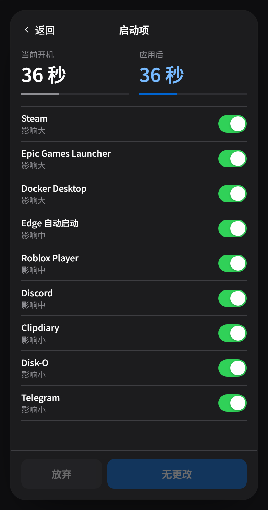
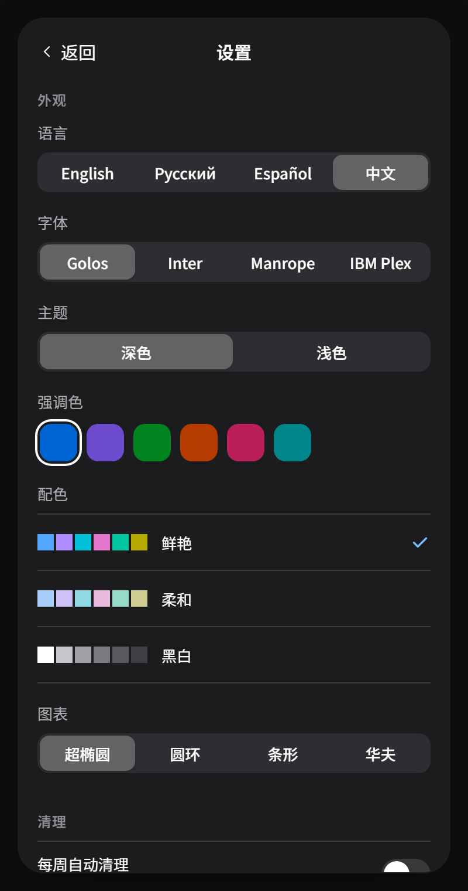
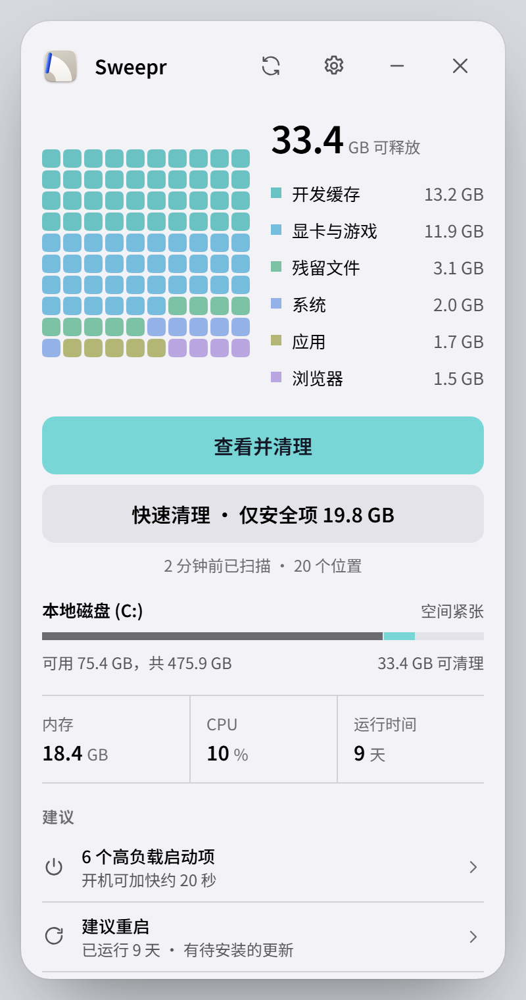

# Sweepr

**一款小巧、谨慎的 Windows 10 和 11 清理工具。**
找出隐藏的垃圾，清楚地告诉你它们是什么，只有在你确认后才会删除。

[English](README.md) · [Русский](README.ru.md) · [Español](README.es.md) · **中文**

[观看高清视频 (MP4)](docs/media/zh/demo.mp4)

## 下载

从[最新版本](https://github.com/rom5n/sweepr/releases/latest)下载 **Sweepr_…_x64-setup.exe** 并运行。
安装程序暂未签名：如果 Windows SmartScreen 提示“Windows 已保护你的电脑”，请选择 **更多信息 → 仍要运行**。
Sweepr 会在此页面检查新版本（可在设置中关闭）。

## 功能

- **找出其他工具遗漏的内容。** 开发缓存（npm、Yarn、pnpm、Go、Cargo、Gradle、NuGet、Playwright…）、显卡着色器缓存、
  Steam 及其他启动器缓存、Electron 应用、浏览器、Windows 更新和应用商店应用缓存、已卸载程序的残留、旧安装包，
  以及永远不会自动缩小的 WSL/Docker 虚拟磁盘。
- **删除前全部展示。** 每一项都显示大小、路径和风险——用颜色、形状和文字表示：安全、低、中、高。默认只勾选安全项。
- **如实测量。** 清理前后都会测量可用空间，报告显示的是真正释放的空间，而不是文件大小之和。
- **稳妥可靠。** 缓存直接删除（应用会自动重建），你自己的文件移至回收站。已打开的文件会被跳过，绝不强制删除。
  正在运行的应用（Steam、浏览器、Discord…）的项目会等你关闭后再处理。
- **只有一次 Windows 提示。** 需要管理员权限的项目会在创建还原点后，由一个小助手一并完成，只弹出一次 UAC 提示。
- **启动项管理**，显示影响程度和开机时间估算；与任务管理器相同的方式禁用，随时可以撤销。
- **常驻托盘。** 快速清理、重新扫描，以及可选的定时自动清理（仅安全项，时间和日期由你决定）。

## 截图

<table>
  <tr>
    <td align="center"> 主页</td>
    <td align="center"> 查看</td>
    <td align="center"> 确认</td>
    <td align="center"> 正在清理</td>
  </tr>
  <tr>
    <td align="center"> 报告</td>
    <td align="center"> 启动项</td>
    <td align="center"> 设置</td>
    <td align="center"> 浅色主题，华夫图</td>
  </tr>
</table>

## 从不触碰

密码和书签、浏览器扩展、应用登录信息和离线数据（Local Storage、IndexedDB）、游戏存档、OneDrive 和 Dropbox 文件夹、
`Windows\Installer`、WinSxS、Prefetch、DriverStore、Docker 卷、虚拟机、AI 模型、数据库文件夹，以及你在
**设置 → 高级 → 排除的文件夹** 中添加的任何文件夹。不做“注册表清理”，也绝不会关闭页面文件、Windows 更新、
Defender、UAC 或 SmartScreen。

## 个性化

四种语言（English、Русский、Español、中文）、深色和浅色主题、六种强调色、三种配色（鲜艳、柔和、黑白）、
四种图表（超椭圆、圆环、条形、华夫）、四种字体、三种圆角样式、减少动画、高对比度以及色盲友好的状态颜色。

## 隐私

无需账户，没有遥测。唯一的网络请求是可选的更新检查，只访问本仓库的发布页面。每个被删除的文件都会记录在本地日志
`%LOCALAPPDATA%\Sweepr\logs` 中。

## 开发者

构建步骤、项目结构、如何添加清理项目、测试和发布流程：[docs/DEVELOPMENT.md](docs/DEVELOPMENT.md)（英文）。
